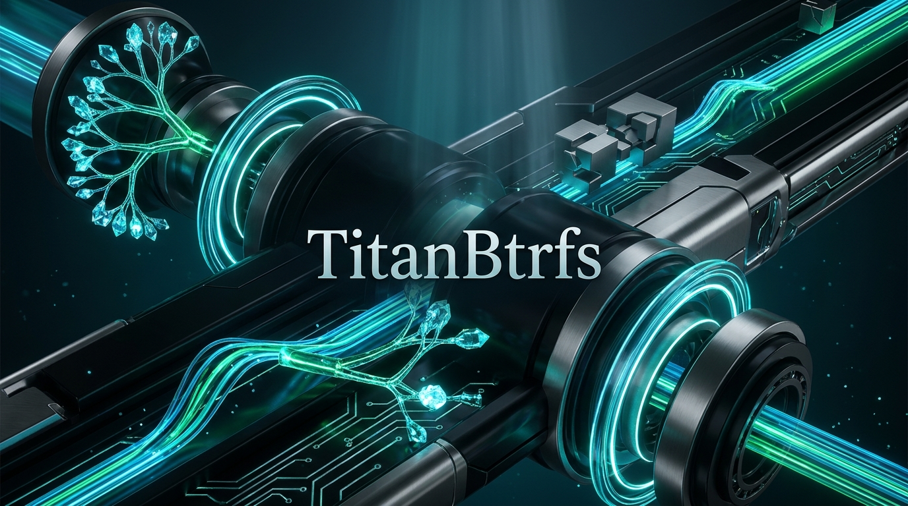

# TitanBtrfs: High-Performance Btrfs Engine for Windows

[](https://github.com/MicaNT-Kernel/TitanBtrfs/actions/workflows/ci.yml)
[](LICENSE)
[]()
[](CLEAN_ROOM_PROVENANCE.md)



**TitanBtrfs** is an independent, clean-room implementation of the **B-tree File System (Btrfs)** architecture designed in modern ISO C++23. Built from first principles, TitanBtrfs delivers userland volume formatting, File Explorer drive mounting via WinFsp, subvolume hierarchies (`@`, `@home`, `@snapshots`), instantaneous Copy-on-Write (CoW) snapshots, Castagnoli CRC32C checksum integrity, and automated self-healing for Windows and POSIX platforms.

---

## Key Features

- **B-Tree Architecture & On-Disk Format**: Clean-room implementation verifying `_BHRfS_M` superblocks at `0x10040`, root trees, chunk trees, and subvolume hierarchies.
- **Copy-on-Write (CoW) & Instant Snapshots**: Atomically clone subvolumes in milliseconds with zero storage overhead until data modifications occur.
- **Subvolume-Aware Windows Mounting (`titanbtrfs_mount`)**: Mount any Btrfs subvolume or snapshot directly to a Windows drive letter (e.g. `B:\`) with native File Explorer, Command Prompt, PowerShell, Steam, and application integration.
- **Steam Deck & Linux External Storage Support**: Seamlessly read and write to Steam Deck microSD cards, Synology NAS USB backups, and Linux external drives without third-party kernel drivers or blue-screen (BSOD) risks.
- **Castagnoli CRC32C Integrity Streams**: Hardware-accelerated checksum verification protecting against silent bit-rot and data corruption.
- **Windows NT Background Service (`titanbtrfs_svc`)**: Background auto-mount engine and 24-hour autonomous B-tree consistency scrubber with Named Pipe IPC (`\\.\pipe\titanbtrfs_ipc`).
- **Self-Healing Inspection Tool (`titanbtrfs_check`)**: B-tree analysis, subvolume auditing, and automated volume repair via `--repair` / `/f`.
- **1-Click Standalone Installer (`titanbtrfs_setup`)**: Single executable embedding all binaries, hero artwork, and the signed WinFsp runtime MSI in an LZ4-compressed payload.
- **Strict Clean-Room Provenance**: 100% written from first principles under 17 U.S.C. § 1201(f) interoperability standards, audited on every commit by our automated Sentinel.

---

## Utilities & Architecture

### 1. `titanbtrfs_mount` (User-Mode Filesystem Bridge)
Mounts any raw disk image (`.raw`, `.img`, `.vhdx`) or physical drive to a Windows drive letter:
```bash
# Mount default root subvolume (@ / ID 5) to B:
titanbtrfs_mount btrfs_disk.img B:

# Mount a specific subvolume (e.g. @home) to H:
titanbtrfs_mount btrfs_disk.img H: --subvol @home

# Mount physical Steam Deck microSD card
titanbtrfs_mount \\.\PhysicalDrive2 B: --label SteamGames
```

### 2. `titanbtrfs_svc` (Windows NT Background Service)
Autonomous service daemon for volume auto-mounting, IPC, and 24-hour B-tree integrity scrubbing:
```bash
# Register and start as Windows Auto-Start Service
titanbtrfs_svc install

# Run in interactive console debug mode
titanbtrfs_svc run

# Uninstall service
titanbtrfs_svc uninstall
```

### 3. `titanbtrfs_check` (Inspection & Scrubber Tool)
Inspect volume boot records, verify B-tree consistency, and perform automated repairs:
```bash
# Inspect volume and list subvolumes
titanbtrfs_check my_disk.img --subvols

# Perform automated repair on corrupted structures
titanbtrfs_check my_disk.img --repair
```

### 4. `titanbtrfs_format` (CLI Formatting Utility)
Format any disk image or physical partition to Btrfs:
```bash
titanbtrfs_format my_disk.img --size 512 --label "SteamDeck"
```

### 5. `titanbtrfs_setup` (Standalone GUI Installer)
Pure Win32 dark-mode GUI installer with Left-Sidebar Studio layout, automatic WinFsp detection, silent driver deployment, PATH configuration, and Windows Add/Remove Programs integration.

---

## Building from Source

### Prerequisites
- CMake 3.24+
- Modern C++23 Compiler (Clang 18+, MSVC 2022 v17.8+, or GCC 14+)
- Ninja build tool (recommended)

### Windows Build (Clang / Ninja)
```bash
cmake -B build -G Ninja -DCMAKE_BUILD_TYPE=Release
cmake --build build -j2
```

### Run Test Battery
```bash
ctest --test-dir build --output-on-failure
# Or directly:
./build/titanbtrfs_tests
```

### Run Clean-Room Sentinel Audit
```bash
node scripts/clean_room_sentinel.js --local
```

### Create Distribution ZIP
```bash
cpack --config build/CPackConfig.cmake -B build/dist
```

---

## Legal & Clean-Room Architecture
TitanBtrfs is an independent clean-room implementation developed for functional interoperability under 17 U.S.C. § 1201(f) and SCOTUS fair use doctrine (*Google v. Oracle*). See [CLEAN_ROOM_PROVENANCE.md](CLEAN_ROOM_PROVENANCE.md) for full compliance declarations.

---

## License
Licensed under the Apache License, Version 2.0.  
Copyright © 2026 Daniel Elliott <ssfdre38@gmail.com>.
